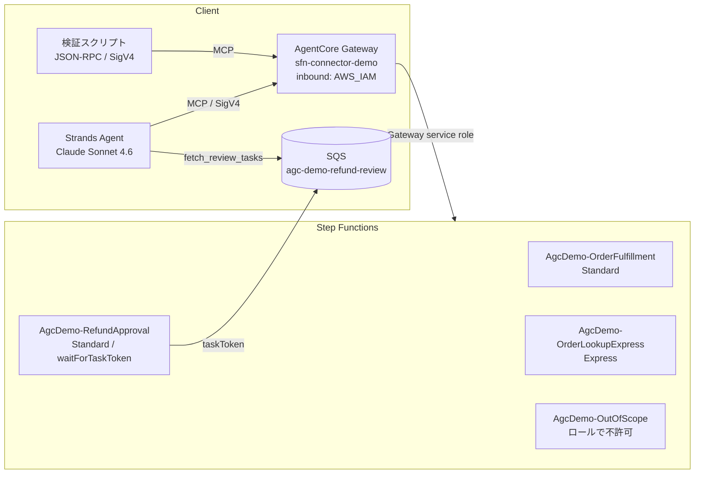

# AgentCore Gateway × Step Functions コネクタ 検証メモ（ブログ下書き用）

- 検証日: 2026-10-30 / リージョン: ap-northeast-1（東京）
- 発表: [AWS Step Functions workflows now available as AI agent tools](https://aws.amazon.com/about-aws/whats-new/2026/10/step-functions-workflows-ai-agent-tools/)（2026-10-29）
- ドキュメント: [AWS Step Functions as Connector Target](https://docs.aws.amazon.com/bedrock-agentcore/latest/devguide/gateway-target-connector-step-functions.html) / [チュートリアル](https://docs.aws.amazon.com/step-functions/latest/dg/tutorial-agentcore-gateway.html)

## 1. 何ができるか（要約）

Gateway のターゲットに組み込みコネクタ `connectorId: "states"`（バージョン `1.0.0`）を追加すると、Step Functions の API 10 種類を MCP ツールとして公開できます。Lambda や MCP サーバー、ツールスキーマを自分で書く必要はありません。

| 区分 | 操作 | 対象 | Standard | Express |
|---|---|---|---|---|
| ステートマシンに固定（pin）する操作 | `StartExecution` | 固定したステートマシン | ✅ | ✅ |
| | `StartSyncExecution` | 固定したステートマシン | ❌ `StateMachineTypeNotSupported` | ✅ |
| | `ListExecutions` | 固定したステートマシン | ✅ | ❌ `StateMachineTypeNotSupported` |
| | `DescribeStateMachine` | 固定したステートマシン | ✅ | ✅ |
| 実行 ARN を受け取る操作 | `DescribeExecution` | エージェントが渡す ARN | ✅ | ❌ `InvalidArn` |
| | `GetExecutionHistory` | エージェントが渡す ARN | ✅ | ❌ `InvalidArn` |
| | `StopExecution` | エージェントが渡す ARN | ✅ | ❌ |
| タスクトークンを受け取る操作 | `SendTaskSuccess` / `SendTaskFailure` / `SendTaskHeartbeat` | エージェントが渡すトークン | ✅（コールバック） | ― |

- pin した `stateMachineArn` はツールスキーマに出ません。エージェントが渡すと Gateway が拒否します。
- pin しない 6 操作の権限は、Gateway サービスロールの IAM ポリシーだけで制御されます。
- Gateway からの呼び出しは CloudTrail 上 `assumed-role/<GatewayRole>/gateway-session-invocation` として記録されます。

## 2. 検証構成



### ステートマシン

| 名前 | タイプ | 内容 | 定義 |
|---|---|---|---|
| `AgcDemo-OrderFulfillment` | Standard | 金額チェック (>100,000 で Fail) → 在庫引当 → Wait(`waitSeconds`) → 出荷 | `statemachines/order_fulfillment.asl.json` |
| `AgcDemo-RefundApproval` | Standard | SQS `sendMessage.waitForTaskToken` でエージェントに審査を依頼し、`approved` で分岐 | `statemachines/refund_approval.asl.json` |
| `AgcDemo-OrderLookupExpress` | Express | 注文 ID からステータスを返す（同期） | `statemachines/order_lookup_express.asl.json` |
| `AgcDemo-OutOfScope` | Standard | IAM 境界の検証用。Gateway ロールでは許可していない | `statemachines/out_of_scope.asl.json` |

### Gateway ターゲット（ツール名は `<target>___<Operation>`）

| ターゲット | 作成方法 | 操作 | pin 先 / 備考 |
|---|---|---|---|
| `orders` | **コンソール** | StartExecution, ListExecutions, DescribeStateMachine, DescribeExecution, StopExecution, GetExecutionHistory | OrderFulfillment |
| `lookup` | boto3 | StartSyncExecution | OrderLookupExpress。ツール説明を日本語で上書き |
| `refund` | boto3 | StartExecution（`name` を公開）, ListExecutions（`maxResults` を公開）, DescribeStateMachine（`includedData=ALL_DATA` に固定して非表示） | RefundApproval |
| `tasks` | boto3 | SendTaskSuccess, SendTaskFailure, SendTaskHeartbeat | pin なし（ドキュメントの推奨どおり別ターゲットに分離） |
| `misconfig` | boto3 | 誤設定の挙動確認用（Standard に StartSync、Express に ListExecutions、pin なし、ロール外のステートマシン） | エージェントには公開しない |

## 3. 手順とスクリーンショット

| # | ファイル | 内容 |
|---|---|---|
| 1 | `screenshots/10_gateways_list.png` | Gateway 一覧（`sfn-connector-demo`、Inbound Auth = IAM） |
| 2 | `screenshots/11_gateway_detail.png` | Gateway 詳細（ページ全体） |
| 3 | `screenshots/15_gateway_service_role_policy.png` | Gateway サービスロールのインラインポリシー |
| 4 | `screenshots/20_add_target_form.png` | Add target 画面（MCP target） |
| 5 | `screenshots/21_select_stepfunctions_connector.png` | Target type「Connectors - new」→ Pre-configured targets「**Step Functions - new**」 |
| 6 | `screenshots/22_state_machine_dropdown.png` | ステートマシン選択（Standard / Express が表示される） |
| 7 | `screenshots/23_standard_sync_warning.png` | 初期状態では 10 操作すべてが選択済み。Standard を選ぶと「StartSyncExecution only works on an EXPRESS state machine」と警告される |
| 8 | `screenshots/25_operations_dropdown.png` | Operations の選択（10 操作のチェックリスト） |
| 9 | `screenshots/24_operations_selected.png` | 6 操作に絞った状態。Outbound Auth は IAM Role だけが選べる |
| 10 | `screenshots/26_target_created.png` / `27_targets_table.png` | 作成直後。Target type は「Step Functions」と表示され、すぐに Ready になる |
| 11 | `screenshots/28_target_detail.png` | ターゲット詳細（操作や pin 先は表示されない） |
| 12 | `screenshots/29_gateway_all_targets.png` | スクリプトで追加したターゲットを含む 5 件 |
| 13 | `screenshots/30_sfn_state_machines.png` | Step Functions 側のステートマシン一覧 |
| 14 | `screenshots/31_sfn_order_executions.png` | エージェントが起動・停止した実行の一覧 |
| 15 | `screenshots/32〜34_*.png` | エージェントが起動した実行（失敗・成功・StopExecution による中断） |
| 16 | `screenshots/37_sfn_refund_waiting_for_task_token.png` | `waitForTaskToken` でエージェントの応答を待っている実行 |
| 17 | `screenshots/35, 36, 38, 39_*.png` | エージェントの SendTaskSuccess / SendTaskFailure で再開・終了した実行 |
| 18 | `screenshots/40_cloudtrail_gateway_role_calls.png` | CloudTrail（ユーザー名 `gateway-session-invocation`） |
| 19 | `screenshots/50, 51_issue_*.png` | 非 ASCII 文字が `?` に化ける問題（後述） |

### コンソールで作ったターゲットの実体（`get-gateway-target`）

```json
{"mcp": {"connector": {
  "source": {"connectorId": "states", "version": "1.0.0"},
  "configurations": [
    {"name": "StartExecution", "parameterValues": {"stateMachineArn": "arn:aws:states:ap-northeast-1:<acct>:stateMachine:AgcDemo-OrderFulfillment"}},
    {"name": "ListExecutions", "parameterValues": {"stateMachineArn": "..."}},
    {"name": "DescribeStateMachine", "parameterValues": {"stateMachineArn": "..."}},
    {"name": "DescribeExecution", "parameterValues": {}},
    {"name": "StopExecution", "parameterValues": {}},
    {"name": "GetExecutionHistory", "parameterValues": {}}
  ]}}}
```

コンソールではステートマシンを 1 つしか選べず、選んだものが pin 可能な操作すべてに適用されます。操作ごとに別のステートマシン（例: `StartSyncExecution` だけ Express）を pin したい場合は API / SDK を使います。

### スクリプト

```bash
export AWS_DEFAULT_REGION=ap-northeast-1
uv sync
uv run python scripts/setup.py         # SQS, ロール, ステートマシン, Gateway
#   → コンソールで orders ターゲットを作成
uv run python scripts/add_targets.py   # lookup / refund / tasks / misconfig
uv run python scripts/exercise.py      # 10 操作の実行 → results/exercise.{log,jsonl}
uv run python scripts/errors.py        # ガードレールとエラー → results/errors.{log,jsonl}
uv run python scripts/agent_demo.py    # Strands エージェント → results/agent_transcript.md
uv run python scripts/cleanup.py       # 後片付け
```

AWS CLI 2.34.45 の `create-gateway-target` はまだ `connector` に対応していないため（`--target-configuration` に `connector` キーがない）、boto3 1.43.122 を使っています。`aws login` の認証情報を boto3 で使うには `botocore[crt]` が必要です。

## 4. 10 操作の実行結果（`results/exercise.log`）

| 操作 | 呼び出し | 結果 |
|---|---|---|
| DescribeStateMachine | `{}` | メタデータのみ。`definition` は `"{}"` |
| DescribeStateMachine | `{"includedData":"ALL_DATA"}` | ASL 定義まで返る |
| StartExecution | `{"input":"{...waitSeconds:3}"}` | `executionArn`, `startDate` |
| DescribeExecution | `{executionArn}` | 既定では input / output を含まない。`ALL_DATA` で input / output が付く |
| GetExecutionHistory | `{executionArn}` | `ExecutionStarted → Choice → Pass → Wait → Pass → ExecutionSucceeded` |
| (Fail 状態) | amount=200000 | `status: FAILED`, `error: AmountLimitExceeded`, `cause` |
| StopExecution | 300 秒待ちの実行 | `{"stopDate":...}` → `ABORTED`。停止済みの実行にもう一度呼ぶと成功し、元の stopDate が返る |
| ListExecutions | `statusFilter` = SUCCEEDED / FAILED / ABORTED | フィルタされた一覧 |
| StartSyncExecution | `{"orderId":"1001"}` | `status`, `output`, `billingDetails` が 1 回の呼び出しで返る |
| StartExecution + `name`（公開済み） | 同じ name・同じ input で 2 回 | 2 回目も同じ ARN が返る（冪等） |
| 〃 | 同じ name・異なる input | `ExecutionAlreadyExists` |
| SendTaskHeartbeat | SQS から受け取ったトークン | `{}` |
| SendTaskSuccess | `output={"approved":true,...}` | ワークフローが再開して `SUCCEEDED` |
| SendTaskSuccess | 使用済みトークン | `TaskTimedOut: Provided task does not exist anymore` |
| SendTaskFailure | `error/cause` | タスクが失敗し、実行が `FAILED`（error がそのまま入る） |
| SendTaskSuccess | `approved=false` | ワークフロー内の Fail（`RefundDenied`）へ進む |
| ListExecutions + `maxResults`（公開済み） | `{"maxResults":2}` | 2 件と `nextToken`（`nextToken` 自体は公開していない） |
| DescribeStateMachine（`includedData` を固定して非表示） | `{}` | 定義込みで返る |

レスポンスは MCP の `result.content[0].text` に Step Functions API のレスポンス JSON がそのまま入ります。`__type` フィールドも含まれます。

## 5. ガードレールとエラー（`results/errors.log`）

| ケース | 結果（`isError: true` の text） |
|---|---|
| pin 済みの `stateMachineArn` を渡す | `IllegalArgumentException - Invalid request parameters: cannot set parameter(s): [/stateMachineArn]` |
| 非表示にした `includedData` を渡す | `... cannot set parameter(s): [/includedData]` |
| 公開していない `StopExecution.error` / `StartExecution.name` を渡す | `... cannot set parameter(s): [/error]` / `[/name]` |
| enum 外の値（`statusFilter: DONE`） | `ValidationException - ... enum validation failed` |
| 必須パラメータが欠けている | `ValidationException - Missing required field(s): 'executionArn'` |
| input が JSON ではない | `DependencyFailedException - {"errorType":"...#InvalidExecutionInput", ...}` |
| 存在しないツール | JSON-RPC error `-32602 Unknown tool` |
| Standard に StartSyncExecution | `StateMachineTypeNotSupported` |
| Express に ListExecutions | `StateMachineTypeNotSupported` |
| Express の実行 ARN に Describe / GetExecutionHistory | `InvalidArn: Resource type not valid in this context: express` |
| pin なしの DescribeStateMachine | ターゲットは作成できるが、呼ぶと `Missing required field(s): 'stateMachineArn'` |
| ロールで許可していないステートマシンに pin | ターゲットは Ready になるが、呼ぶと `AccessDeniedException`（`.../gateway-session-invocation is not authorized to perform: states:StartExecution`） |
| ロール外の実行 ARN に Describe / Stop | `AccessDeniedException`。pin なしの操作の範囲は IAM で絞れている |
| 偽のタスクトークン | `InvalidToken` |
| SendTaskSuccess の output が JSON ではない | `InvalidOutput` |
| 署名なしのリクエスト | HTTP 401 `Authentication error - Invalid credentials` |

Step Functions 側のエラーは `DependencyFailedException - {"errorType": "...#<Step Functions のエラー名>", "errorMessage": ..., "service":"states", "operation": ...}` という形で返ります。Gateway 側の入力検証エラーは `IllegalArgumentException` / `ValidationException` です。

## 6. ハマりどころ・気づき

1. **非 ASCII 文字が `?` に化ける（要注意）**
   - ツール引数の文字列に含まれる日本語などは、Step Functions に届いた時点で `?` に置き換わります。
     - `StartExecution` の `input` に生の日本語を入れた場合 → 保存された input が `"note": "?????"`（`screenshots/51_*`）
     - `SendTaskFailure` の `error` / `cause` → `??????` / `???????????`（`screenshots/50_*`）
     - 同じ値を boto3 から直接 `send_task_failure` すると正しく保存されます（`results/errors.log` の T3 compare）。
     - リクエスト本文を `\uXXXX` でエスケープしても、生の UTF-8 で送っても結果は同じでした。
   - 回避策: `input` / `output` は JSON 文字列なので、中身を `\uXXXX` にエスケープしてから渡せば正しく届きます（`json.dumps(..., ensure_ascii=True)`）。エージェント側では Strands の `BeforeToolCallEvent` フックで再シリアライズしています（`scripts/agent_demo.py` の `GatewayToolHooks`）。`error` / `cause` は単なる文字列なので回避策がなく、システムプロンプトで ASCII（英語）に限定しています。
   - [INFERENCE] コネクタ v1.0.0 の不具合と考えられます。報告の価値があります。
2. **全エントリに `parameterValues` がないターゲットは作成できない**
   - `tasks` のように `{"name": "SendTaskSuccess"}` だけを並べると `ValidationException: Connector configurations must not be empty.` になります。`"parameterValues": {}` を付ければ作成できます（コンソールも空オブジェクトを付けています）。ドキュメントには「parameterValues なしで追加」と書かれているので、ここは食い違っています。
3. **ツール説明を上書きすると、組み込みの注意書きが消える**
   - 組み込みの説明には「Express workflows only; fails on a Standard state machine.」などの制約が書かれています。`description` を指定すると全文が置き換わるので、必要なら自分で書き足します。
4. **`parameterOverrides` の `path` は `$.name` の形式**（KB コネクタと同じ）。`visible:false` と `parameterValues` を組み合わせると「固定値で非表示」にできます（例: `includedData=ALL_DATA` に固定）。
5. **誤設定はターゲット作成時には検出されない**
   - pin なし、Express / Standard の取り違え、ロール外への pin はいずれも `READY` になり、呼び出し時に初めて失敗します（コンソールは Standard × StartSync だけ警告を出します）。
6. **pin しない操作はターゲットをまたいで使える**
   - `orders___DescribeExecution` で `RefundApproval` の実行も参照できます（ロールで許可していれば）。エージェントは実際にそう使っていました。範囲を絞りたい場合は IAM で絞るか、Gateway を分けます（サービスロールは Gateway 単位）。
7. **タスクトークンの受け渡しは自前で用意する**
   - コネクタはトークンを配信しません。今回は SQS に送り、エージェントのローカルツール（`fetch_review_tasks`）で受け取りました。`SendTask*` は IAM で `Resource: "*"` 以外を指定できないので、トークンそのものを秘密情報として扱います。
8. **監査**: CloudTrail に残る呼び出し元は Gateway ロール（`gateway-session-invocation`）だけで、どの IAM プリンシパルやエージェントが Gateway を呼んだかは Step Functions のイベントには残りません。input は `HIDDEN_DUE_TO_SECURITY_REASONS` と表示されます。
9. **DescribeStateMachine の既定値**は `definition: "{}"`。定義が欲しい場合は `ALL_DATA` を指定します。
10. ターゲットの作成・更新は数秒で `READY` になり、Sync は不要でした。

## 7. エージェントのデモ（`results/agent_transcript.md`）

Strands Agents 1.62 と `jp.anthropic.claude-sonnet-4-6` を使い、`MCPClient(url=..., auth_provider=SigV4HttpxAuth())` で Gateway に接続しました（SigV4 は `httpx.Auth` で自前実装）。

| ユーザーの依頼 | エージェントが呼んだツール |
|---|---|
| 注文 1002 と 1004 の状況 | `lookup___StartSyncExecution` ×2（並列）→ PROCESSING / NOT_FOUND |
| D-3001 を出荷して追跡番号を教えて | `orders___StartExecution` → `DescribeExecution` → `sleep_seconds` → `DescribeExecution` → `TRK-D-3001` |
| D-3002（150,000 円）を出荷して | `StartExecution` → `DescribeExecution` → `AmountLimitExceeded` と代替案を提示 |
| D-3003 を開始 → キャンセルして止めて | `StartExecution` → `StopExecution` → `DescribeExecution`（ABORTED を確認） |
| 失敗・中断した実行と原因は? | `ListExecutions(FAILED)`, `ListExecutions(ABORTED)` → `DescribeExecution` ×6 で原因を要約 |
| 返金申請 3 件を受け付けて | `refund___StartExecution` ×3（`name: refund-R-1x` を冪等キーに使用） |
| 審査キューを処理して | `fetch_review_tasks` → 破損は `SendTaskSuccess(approved:true)`、サイズ違いは `SendTaskSuccess(approved:false)`、自己都合は `SendTaskFailure(RefundRejected)` |
| 3 件の最終結果は? | `orders___DescribeExecution` ×3（別ターゲットのツールで返金ワークフローを参照） |

最初の実行では、「受け付けて」と頼んだだけでエージェントが審査まで進めてしまいました。システムプロンプトに「審査は指示されたときだけ」と書き足して再実行し、上の結果になりました。ワークフローの手順自体はエージェントが変えられないので、どこまで任せるかはプロンプトとツールの公開範囲で決めることになります。

## 8. 後片付け

`uv run python scripts/cleanup.py` で、Gateway ターゲット、Gateway、ステートマシン 4 つ、SQS キュー、IAM ロール 2 つを削除します。
